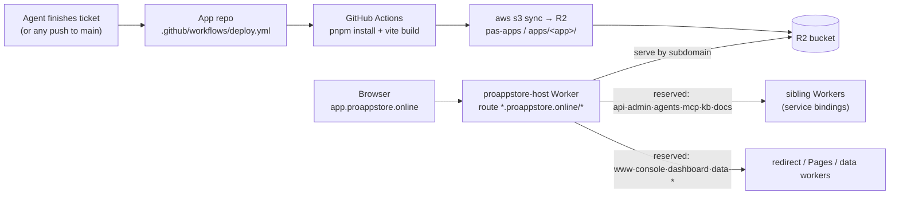

# Build & Deploy — current state vs future state

> **App requirements** for deployment — the keyless workflow, evidence per deploy, rollback and smoke tests — are clauses in the [Application Standard — Operations chapter](./standard/ops.md) ([PAS-OPS-005](./standard/ops.md#pas-ops-005), [009](./standard/ops.md#pas-ops-009), [010](./standard/ops.md#pas-ops-010)). This page describes the platform path those clauses cite.

How a PAS app gets from a git push to a live URL, what we watch, and where this
goes if we ever centralize. Decision record: [ADR-006](./adr/006-centralized-build-service.md).

## Current state (what runs today)

**Per-repo GitHub Actions → R2 → one host Worker (Path B).**

1. **App repo** carries `.github/workflows/deploy.yml` (the canonical workflow).
   On push to `main` it runs `pnpm install` (`--frozen-lockfile` when a lockfile is
   committed) and the app's `build` script, which fails the deploy if its `tsc` or
   `pas check` prebuild fails; only a bundle with no build script falls back to a
   bare `vite build` (#204). The output (layout-adaptive: `dist/` or `web/dist/`)
   is `aws s3 sync`ed to the `pas-apps` R2 bucket under `apps/<app>/`, after
   `migrations.json` is applied and `mcp.json` is registered.
   - **Migration chain test** (#503). Before `migrations.json` is applied to
     production, the deploy applies the whole chain to a fresh D1 on workerd's own
     engine (miniflare, fetched by `npx`, never a dependency of the app) and runs
     every `mcp.json` action once with schema-valid sample params. It fails the
     deploy on a migration statement that errors, and on an action whose SQL
     errors for any reason other than a constraint rejection. This catches what
     `node:sqlite` lets through, such as a trigger that applies cleanly but breaks
     every insert. A constraint rejection with sample values (a foreign key, a unique
     index, a trigger's `RAISE`) is reported, not failed. If the check cannot start
     a D1 it retries once and then fails closed. Run it locally with
     `npx -p @proappstore/cli@latest -p miniflare pas migrations test`.
   - **App worker step** ([App workers](./app-workers.md), ADR-009). This step
     is for apps with a `worker/package.json`. It runs between the migrations
     and the `mcp.json` registration, so a first deploy's hooks register
     against a worker that already exists.
     - It builds `worker/` to `worker/dist/app.js`.
     - It uploads the modules with GitHub OIDC to
       `PUT /v1/apps/<app>/worker/oidc`. No Cloudflare credential is involved.
     - The platform refuses the upload with `403` unless an admin has enabled
       app workers for the app.
     - Apps without `worker/` skip the step.
     - When Actions cannot run, the owner can upload the same bundle with a
       session instead: `pas worker deploy` uploads to
       `PUT /v1/apps/<app>/worker`, which applies the same flag and bundle
       checks (#406).

     The step is not yet in the canonical `deploy.yml` (#305).
2. **`proappstore-host`** (one Worker, route `*.proappstore.online/*`) serves every
   app from R2 by subdomain, and dispatches reserved subdomains (`api`, `admin`,
   `agents`, `mcp`, `kb`, `docs`) to sibling Workers via service bindings.
   `www` redirects to the apex; `console` and `dashboard` point to the
   Pages-hosted control surfaces; `data-*` is reserved for generated app data
   workers.
3. **Where the workflow comes from:**
   - **Vibecode** (agent-teams): `provisionApp` strips any agent-authored
     workflow and injects the canonical `deployWorkflowYaml()` — the platform
     owns CI on this path.
   - **CLI / MCP**: the repo is cloned from `template-app`, which carries the
     canonical workflow.
   - Either way the app's `deploy.yml` is a thin caller (#427): the pipeline
     itself is the platform's reusable workflow (see below).



### The reusable deploy pipeline (#427)

A full workflow copied into every repo drifted: the `cache: pnpm`-without-lockfile
landmine broke ~21 repos, and doordrop missed the #393 source-map steps and the
marketing publish. The pipeline now lives once, in this repo, and every app calls it:

```yaml
# the app's .github/workflows/deploy.yml (deployWorkflowYaml(), the golden)
name: Deploy to R2
on:
  push:
    branches: [main]
permissions:
  contents: read
  id-token: write
concurrency:
  group: deploy-${{ github.repository }}
  cancel-in-progress: true
jobs:
  deploy:
    uses: proappstore-online/platform/.github/workflows/app-deploy.yml@app-deploy-v1
    secrets: inherit
```

- **The pipeline:** `.github/workflows/app-deploy.yml` (`on: workflow_call`):
  - the steps are the router, build, migrations, app worker, tool registration,
    source maps, keyless R2 upload, marketing site, QA and E2E;
  - this repo is public, so any repository can call it, including
    `ChessClubs-online/chess-clubs`.
- **Releases:** the moving tag **`app-deploy-v1`**.
  - A compatible change merges to `main`, then moves the tag
    (`git tag -fa app-deploy-v1 <sha>`, `git push -f origin refs/tags/app-deploy-v1`).
    The next push of every app runs it, with no per-repo edit.
  - A breaking change is `app-deploy-v2`, and callers move when they are ready.
- **What the caller keeps:** what a reusable workflow cannot own.
  - The trigger.
  - The run name *Deploy to R2*: the Agent Teams deploy gate matches it.
  - `id-token: write` for the OIDC steps.
  - Concurrency.
  - `secrets: inherit`, so the runner router gets its repo-level `RUNNER_BILLING_TOKEN`.
  - OIDC claims stay the caller's (`repository`, `ref`), which is what the
    platform authorizes.
- **Per-app options are inputs**, not edits. An app adds
  `with:` under `deploy:`:

  | Input | Values | Default |
  |---|---|---|
  | `e2e` | `auto` (root `e2e/`, else `web/tests/e2e` + `web/playwright.config.*`), `e2e`, `web`, `none` | `auto` |
  | `marketing` | `auto` (when `marketing/package.json` exists), `true`, `false` | `auto` |
  | `source-maps` | `auto` (upload hidden maps when the build emits them), `false`; maps are always stripped from the public build | `auto` |
  | `node-version` | Node.js major | `22` |

  `workflow_call` has no choice type, so the pipeline's first step refuses an
  unknown value. An extra check (lint, tests) is its own job, with
  `deploy: needs: [that-job]`.
- **Guards:**
  - **The pipeline:** `packages/admin/src/publish.test.ts` holds it to the #264
    rule. It may not run `wrangler`, call the Workers scripts API, name a
    `pas-data-`/`pas-app-` Worker, or read any secret but the two it declares.
  - **App repos:** the `deploy-workflow` compliance check warns on a `deploy.yml`
    that is not a caller, and `[SECURITY]` on any workflow that does those things.
  - **The scaffold:** `template-workflow-drift` in `ci.yml` and
    `scripts/sync-template-workflow.mjs --check` keep template-app's caller equal
    to the golden, which a unit test pins to `deployWorkflowYaml()`.

**What we're watching:** how often workflow drift still surfaces despite these
guards (e.g. agents inventing new workflow variants, lockfile breakage on new
apps, per-repo edits). If it keeps recurring — or once private-repo Actions cost
or multi-org demand bites — that's the signal to migrate (below).

### Browser source maps (#393, ADR-008 decision 7)

Browser crashes are symbolicated on read from source maps the app's own deploy
uploads as a **private release artifact**: never the public `pas-apps` bucket.

- **On by default for new apps.** The approved templates (`template-app`,
  `template-marketplace`) and the staged ones under `templates/` build with
  `build: { sourcemap: 'hidden' }`, give the service worker no map
  (`workbox.sourcemap: false`), and pass the deploy's commit as
  `initPro({ monitoring: { build: { sha: import.meta.env.VITE_COMMIT_SHA } } })`;
  the canonical build step exports `VITE_COMMIT_SHA`. An existing app opts in
  with the same three lines, as ChessClubs did (chess-clubs#217).

- **Upload.** `POST /v1/apps/:appId/sourcemaps?commitSha=<sha>`, authenticated
  with the app repository's GitHub OIDC token on `main` (no secret). The commit
  must be the one the workflow runs for. Body: one JSON bundle
  `{ "files": { "<asset path>": <v3 source map> } }` covering every chunk of the
  build, at most 20 MB and 500 maps, relative paths only. It is stored in the
  private `STORAGE` bucket under `_sourcemaps/{appId}/{sha}/bundle.json` with
  its SHA-256 in `release_sourcemap_manifests`. A release is immutable: a second
  upload for the same commit is `409`.
- **Read.** Owner-only: `POST /v1/apps/:appId/sourcemaps/:sha/symbolicate`
  with frames, or `GET /v1/apps/:appId/logs?symbolicate=true`, which maps each
  row's `data.stack` through the release its own `build.sha` names. Every
  result carries a status: `ok`, `missing` (no release for that SHA, or the row
  has no build SHA), `unavailable` (expired or its bundle is gone),
  `mismatched` (stored bytes differ from the recorded digest) or `skipped`
  (per-request limit). Anything but `ok` leaves the frames raw and marked
  `unresolved`; the raw stack is always kept. A frame's URL is only parsed for
  its path inside the release, never fetched.
- **Retention: 30 days**, the log-detail window. A release's maps stay valid
  for that whole window even after newer deploys.
- **Late events and rollback.** Symbolication uses the release whose SHA equals
  the event's `build.sha`, exactly — never the latest. A crash from an older
  cached PWA build, or an app rolled back to an older release, resolves while
  that release is inside its 30 days; after that its frames come back
  `unavailable`, never mapped against another release.
- **Sweep.** Daily on the backend cron (03:45 UTC), at most 100 releases per
  step: an expired release's bundle is deleted and its row kept as an `expired`
  tombstone (so it reads `unavailable`, not `missing`); tombstones are deleted
  a year after upload. Each run logs `[sourcemaps] sweep expired=… removed=…`.
- **Cost.** A bundle is stored once and parsed on each read; there is no
  cross-request cache. One logs request loads at most 3 releases and
  symbolicates at most 20 rows; the symbolicate endpoint takes at most 50
  frames for one release.
- **No public maps.** The deploy must not publish `.map` files to `pas-apps`,
  and the host refuses to serve any `*.map` path regardless. The canonical
  workflow enforces it twice, after ChessClubs (chess-clubs#217):
  - *Strip* deletes every map from the build, then fails the deploy if one is
    left, or if a service-worker precache still lists a `.map` (a precached map
    that was deleted makes the service worker fail to install).
  - *Verify source maps are not public* runs after the R2 upload. It requests up
    to five of the stripped paths from `https://<app>.proappstore.online/` and
    fails if any response is a source map, whatever its status, so an SPA
    fallback or a private app's refusal is not a false alarm.

### Known limitations of the current state
- A CI workflow lives in every repo (the root cause of drift).
- Private repos burn metered GitHub Actions minutes.
- Multi-org (a creator's own-org repo) isn't cleanly supported (org-level R2
  secrets + `proappstore-online` assumptions).

## Future state (if/when we centralize)

**Cloudflare's first-party stack — NOT a hand-rolled build pipeline.**

| Concern | Target |
|---|---|
| Build on push | **Workers Builds** (native CI/CD; GA). 6,000 build-min/mo + $0.005/min, 6 concurrent, 20-min timeout. |
| Serve the app | **Workers Static Assets** (serve from the Worker; no R2-upload step). 100k assets/version. |
| Many apps / multi-tenant | **Workers for Platforms** — dispatch namespace, **unlimited** tenant Workers; a dispatch Worker routes `<app>.proappstore.online` → the tenant Worker (replaces host's R2 lookup). |
| Multi-org | Workers Builds connects any GitHub/GitLab repo; no org-secret sharing. |

This eliminates the per-repo workflow entirely (no drift possible), removes the
GitHub Actions cost, and supports multi-org — the three current limitations, gone.

### Cost (not the blocker)
~**$25/mo flat** for Workers for Platforms at this scale (1,000 Workers / 20M
requests / 60M CPU-ms included; we have ~25 apps and ~zero pre-launch traffic),
on top of the existing $5/mo Workers Paid.

### The actual blocker: migration
This is a real re-architecture from Path B: every app becomes its own Worker with
static assets, the host Worker's R2-lookup routing becomes a dispatch Worker, and
build/deploy moves to Workers Builds. Migrating a working system carries effort
and risk that isn't justified until the limitations above actually hurt.

## Trigger conditions — when to revisit
Migrate to the future state when **any** of these becomes real:
- Workflow drift keeps surfacing despite the guards (operational toil).
- Private-repo GitHub Actions minutes become a meaningful cost.
- A creator needs their proprietary app in **their own org/repo** (multi-org).
- App count grows enough that per-repo CI maintenance is a burden.

Until then: **keep the current state, keep the guards, watch the drift.**

## History
A centralized build service was prototyped on Cloudflare Containers (Phases 1–3,
2026-06-16/17) and removed after research showed it reinvented Workers Builds.
Full details + how to resurrect: [ADR-006](./adr/006-centralized-build-service.md).
