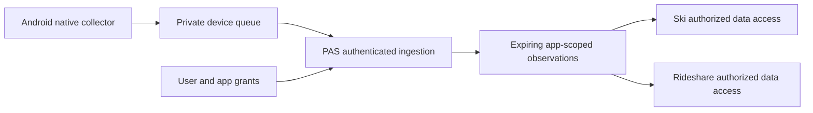

# PAS native companion

The native ProAppStore app serves **people using PAS apps**. It supplies native device capabilities while the apps remain websites/PWAs. It is not the creator console, a web-app container, an alternative app marketplace, or an arbitrary-code runtime.

Decision: [ADR-015](./adr/015-native-companion.md). User guide: [using the companion](./native-companion-users.md). Policy research: [store review](./native-companion-review.md).

## Intended experience

Install PAS and connect the same PAS account once. When Ski needs location, its permission action should open PAS directly to Ski's disclosure. The user enables automatic location for Ski and grants the Android permissions. PAS can then collect and upload while Ski is closed. Rideshare may independently receive the same observations when separately authorized. Their server-side processing produces app-specific routes and trip state.

The user does not need to open PAS for each ride. The native app remains available to see connected apps, pause collection, revoke access, inspect synchronization status and disconnect the phone. System permission prompts name **ProAppStore**; the per-app consent screen names **Ski**, **Rideshare**, etc.

## Architecture

The Android implementation uses Kotlin, Compose/Material 3, Android LocationManager, a location foreground service, SQLite, Android Keystore and WorkManager. LocationManager avoids a Google Play Services dependency. WorkManager retries upload; it is not used as a continuous GPS timer. All backend execution and storage remain on Cloudflare. The iOS implementation (ADR-016) uses Swift/SwiftUI, Core Location background updates with the system location indicator, the Keychain (`AfterFirstUnlockThisDeviceOnly`) and a system-SQLite queue; it is installed directly from Xcode and has no store distribution.

## What is implemented

| Area | Initial implementation |
|---|---|
| Android UI | Store tab (public catalogue, browse only, ADR-017), Sharing control room (per-app state, shared time, upload queue, sync health, device status, track view, activity log), Settings (account, clear history, disconnect). Open hands `https://<id>.proappstore.online/?install=1` to the browser. No developer tooling, no WebView. |
| iOS UI | Same consumer screens in SwiftUI; While Using is enough for a session started in the app, Always is an optional restart upgrade. |
| Identity | Existing PAS Google/GitHub identity through the system browser; explicit device connection approval; proof-bound single-use exchange. |
| Credentials | Random device credential, hashed server-side, AES-GCM protected by Android Keystore on device; 90-day expiry; no general PAS session given to Android. |
| Location | Explicitly enabled automatic collection, foreground service notification and Pause all action; precise and background permission checks. |
| Offline | Durable SQLite queue; recipient grant snapshot per observation; only exact acknowledgements remove queued batches. |
| Platform | Per-device/app grants, validated idempotent upload, app/user-isolated read, disconnect and seven-day raw buffer retention. |
| Recipient apps | Ski (first integration), Run (runs and walks while locked) and Rideshare (`loopride`, drivers' live position for dispatch and the rider). Each has its own reviewed disclosure in the platform catalog. |
| Heart rate | Run's `heart_rate.ble` (#631): a user-chosen standard Bluetooth heart-rate strap (GATT `0x180D`/`0x2A37`), read with the phone locked through Core Bluetooth's `bluetooth-central` background mode. Only bpm and time are uploaded, to `native_heart_rate`; the sensor's name and identifier stay on the phone. Same 7-day buffer, own queue capped at 100,000 samples. The control room shows heart rate under Run's row (state, current bpm, samples waiting, last upload, last reading, its own sync health); the activity log records its events; a 30-day on-device copy of shared samples (`share_hr`, never uploaded) draws a bpm chart on the session's time axis. Android (#634) runs heart rate in the same collector foreground service (`location|connectedDevice`, started with only the permitted, active types) over `connectGatt(autoConnect = true)`. |
| Live relay | Rideshare's accepted points run its `native_driver_location` action as the driver within seconds (see [Live relay](#live-relay)). Ski and Run have no relay; they read on return. |

## Native API, version 1

Base: `https://api.proappstore.online/v1`. Native credentials are accepted **only** by `/native/*`, not actions, billing, publishing, account governance or other app APIs. Error responses must never include location bodies or credentials.

| Endpoint | Caller / behaviour |
|---|---|
| `POST /native/auth/start` | Installation sends SHA-256 hex challenge and device label; receives pending ID and HTTPS browser authorization URL. |
| `GET /native/auth/authorize?id=…` | Sets host-only browser binding; shows matching phone code and existing provider choices. |
| `GET /native/auth/callback?code=…` | Redeems PAS one-time code server-side; displays account/device confirmation. No location grant is created. |
| `POST /native/auth/approve` | Bound browser, exact platform Origin and CSRF nonce; approves account connection. |
| `POST /native/auth/complete` | Installation presents pending ID and original random verifier; 202 while pending; atomically consumes approval and issues a narrow credential. |
| `GET /native/me` | Device account, installation expiry and current grants. `apps` lists the reviewed **location** entries only, in the original shape shipped clients decode; `capabilities` lists every reviewed (app, capability) entry as `{ appId, appName, capability, name, purpose, disclosure, version, grant }` (ADR-018 §7). |
| `PUT /native/apps/:appId/location` | Device submits `enabled: true` and current disclosure version after native confirmation. Same as the capability path below with `location.background`. |
| `DELETE /native/apps/:appId/location` | Revokes this installation's location grant for the app and its raw platform points. Other capability grants are untouched. |
| `PUT /native/apps/:appId/capabilities/:capability` | Enables one reviewed (app, capability) entry: `enabled: true` and that entry's current version. 404 for a pair with no reviewed entry. |
| `DELETE /native/apps/:appId/capabilities/:capability` | Revokes this installation's grant for that one capability; the app's other grants are untouched. |
| `POST /native/locations` | Batch of 1–100 observations, each with UUID, epoch-ms time, latitude, longitude, accuracy and captured grant IDs. |
| `POST /native/heart-rate` | `{ samples }`: 1–300 heart-rate samples `{ id, at, bpm, grants }`, integer bpm 25–250, at most 7 days old; body ≤ 40 KB. Stored only for a current `heart_rate.ble` grant the sample names, at or after its consent; every sample is acknowledged, including those discarded. Its own quota (200 uploads per 15 min per device). |
| `DELETE /native/device` | Revokes installation and cascades its grants/raw points. |
| `GET /apps/:appId/native/locations?after=…&afterId=…` | Current signed-in web app user, bound to that app. Up to 500 points ordered by timestamp and composite cursor. |
| `GET /apps/:appId/native/heart-rate?after=…&afterId=…` | Same gate as the locations read. Up to 1,000 `{ id, at, bpm, cursorId }` samples ordered by timestamp and composite cursor. 404 for an app without a heart-rate entry. |
| `GET /apps/:appId/native/status` | Current signed-in web app user, bound to that app. `{ available, enabled, lastPointAt, capabilities }` — the top-level fields are location's; `capabilities` maps each capability id the app has an entry for to `{ available, enabled, lastAt }`. No device identities. |

The public listing (`GET /v1/storefront/apps/:id` and each item of `GET /v1/storefront/apps`) carries `nativeCapabilities: [{ id, name }]` from the same registry, `[]` when the app has none.

No API accepts a device-supplied account identity. Upload recipients must be active grants for that credential's device. A publisher transfer or disclosure revision invalidates delivery/read access. A new grant cannot adopt pre-consent or previously queued data. The response acknowledges points that were saved or intentionally discarded because their recipient was revoked; the phone must not retry those into another grant.

The read cursor is `(at, cursorId)`, not timestamp alone: multiple devices can produce observations at the same millisecond. Read access checks current authorization again. App-owned workers do not yet have a native RPC; do not give them a device credential or bypass the user/app scope checks.

## Live relay

A reading app can only catch up when its page is open. Rideshare needs a locked phone's driver to stay visible to dispatch and to the rider, so its catalog entry has a **relay** (#654): points its grants accept are run into one app action, as the driver.

- **Binding.** `NATIVE_RELAYS` in `packages/backend/src/lib/native-companion.ts` maps an app to its relay action. It is kept apart from `NATIVE_CATALOG`, so adding it changed no entry's hash. Only `loopride` has one, mapped to `native_driver_location`. An app's manifest cannot choose to receive points.
- **The action.** It must list `"native"` as its only caller (`"callers": ["native"]`), be an `execute` or `batch` action with `requires_auth: true` and no role gate or `step_up`, and declare exactly the params `lat` (`number`), `lng` (`number`), `accuracy` (`number`, metres) and `at` (`integer` or `timestamp_ms`, epoch ms of the fix). `:__user_id` is the device's owner, and the usual `:__user_id` scoping lint applies. Registration refuses `"native"` on any other action, in any other app, or in any other shape. Delivery checks the same rules again. No session, app token, worker or hook can call it, and MCP does not list it.
- **What the action gets.** Only those four params. No device id, device label or grant id reaches the app.
- **Delivery.** When `POST /native/locations` saves a new point for a relayed app, the upload arms that (app, user) on the app-events queue (`pas-app-events`). The delivery reads the **newest** current point when it runs, using the read's own authorization (`NATIVE_LOCATION_SCOPE`). An upload made while a delivery is queued coalesces into it. Only a point newer than the last one relayed is sent. Deliveries for one (app, user) are at least 3 s apart. A point saved while a delivery runs is relayed by a follow-up delivery 3 s later.
- **Stopping.** Revocation, a publisher transfer, a disclosure (contract) change and device expiry stop delivery, including for a point already queued. The predicates are the read's, so the relay can never send a point the read would not return.
- **Failures.** A data-worker 5xx is retried with the queue's backoff (5 retries, then dead-lettered). A 4xx means the action refused the point: it is dropped and not retried. A lost or dead-lettered delivery frees the relay, and the next upload re-arms it. The relay stores no location of its own: `native_relays` (migration 0147) holds only scheduling state.
- **Quotas.** Relayed runs do not count toward the app's hook quota. They are bounded by the upload limit (200 uploads per device per 15 minutes) and the 3 s spacing.

## Permissions and data lifecycle

- OS permission authorizes PAS to collect. A PAS app grant authorizes a specific recipient. Neither substitutes for the other.
- Consent says **automatic background route recording**, not just a generic location toggle. It covers collection while both apps are closed.
- Grants default off. Enabling another app or changing its disclosure does not extend an existing consent.
- Native disable immediately blocks that recipient and removes it from queued observations. If offline, server revocation is pending until synchronization; the UI says so. Online delivery already in flight cannot be recalled.
- Pause all stops new samples. Pausing one app stops tagging new samples for that recipient only; its grant, consent and platform copy are unchanged, and it resumes without a new disclosure. Previously authorized queued samples can still upload in both cases. Pause is local to the phone and is not reported to the app.
- A queue reaching 60,000 pending observations stops collection visibly rather than silently dropping recent samples. Local observations expire after seven days during synchronization; platform reads exclude older points immediately and the maintenance tick deletes them.
- iOS and Android keep a 30-day on-device history (`share_events`, `share_points`) in the protected queue database for the user's own map, timeline and activity log. It is never uploaded and is cleared on disconnect. Android draws the track on a plain Compose canvas with no map tiles.
- The platform's raw buffer is not the app's permanent ride database. Saved/derived rides require app-owned retention and deletion, disclosed separately.
- App/account/device deletion uses cascading foreign keys. Publisher changes invalidate reads/writes immediately and maintenance removes obsolete grants.
- Android backup and device transfer exclude credentials and location data. The app makes no coordinates or tokens available to other Android apps, URLs, logs or analytics.
- Device credentials expire after 90 days in v1. Reconnection is explicit. Silent renewal with rotation is a later protocol change.

## Android execution limits

The collector is an Android location foreground service with an ongoing notification. The user can pause it. Foreground and background location are requested incrementally, with an explanation before the system flow. Denied precise/background permission prevents collection. Approximate-only permission cannot silently become precise route tracking.

The service can continue with the screen locked after it starts. OS force-stop, permission changes, battery restrictions and GPS loss can interrupt collection. `START_STICKY` is not a guarantee, and v1 has no boot receiver. Returning to the app can restart an enabled collector after prerequisites are satisfied. No fake audio, accessibility service, battery-policy bypass or downloaded native code is used.

An Android intent can bring PAS forward but cannot grant access. The initial custom URI carries no credentials. Verified App Links require a release signing certificate and Digital Asset Links deployment before public distribution.

## Next delivery milestones

1. Finish physical-device acceptance and production connection/consent tests; add credential management/rotation and verified App Links. Account linking beyond existing Google/GitHub providers remains a platform auth concern.
2. Add a platform-owned web consent/request SDK surface with account-bound handoff and status. Connect Ski without changing its map provider; deduplicate native and browser recording explicitly.
3. Add an app-worker native capability declaration, authenticated native event/RPC delivery, revocation-aware retries, quotas and downstream deletion. Reuse ADR-009; never permit an arbitrary app worker to enumerate users or read another app's stream. The catalog-bound [live relay](#live-relay) into one app action (#654) is the first such delivery. A general worker RPC remains open.
4. Review and register additional recipient apps (Run and Rideshare registered 2026-11) with real disclosures and lifecycle tests.
5. Add lock-screen activity summaries/timers once app-specific session state is available. A native location service alone cannot infer a ski ride's timer semantics.
6. Complete privacy policy, Data Safety declaration, Play background-location/FGS demonstration, store assets and a closed testing release. Signed release automation is documented in the [Android release runbook](./native-android-release.md). No Play submission or approval has occurred.

## Further native capabilities

The companion grants more than location through the native capability registry: reviewed (app, capability) entries in `packages/backend/src/lib/native-companion.ts`, each with its own consent, data-flow shape, retention and server enforcement. See [ADR-018](./adr/018-native-capability-registry.md). The capability backlog is [#636](https://github.com/proappstore-online/platform/issues/636).

Build and local tests: [`android/README.md`](https://github.com/proappstore-online/platform/blob/main/android/README.md).
