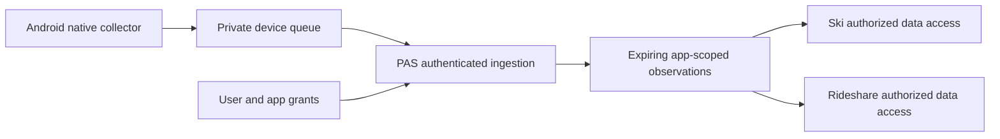

# PAS native companion

The native ProAppStore app serves **people using PAS apps**. It supplies native device capabilities while the apps remain websites/PWAs. It is not the creator console, a web-app container, an alternative app marketplace, or an arbitrary-code runtime.

Decision: [ADR-015](./adr/015-native-companion.md). User guide: [using the companion](./native-companion-users.md). Policy research: [store review](./native-companion-review.md).

## Intended experience

Install PAS and connect the same PAS account once. When Ski needs location, its permission action should open PAS directly to Ski's disclosure. The user enables automatic location for Ski and grants the Android permissions. PAS can then collect and upload while Ski is closed. Rideshare may independently receive the same observations when separately authorized. Their server-side processing produces app-specific routes and trip state.

The user does not need to open PAS for each ride. The native app remains available to see connected apps, pause collection, revoke access, inspect synchronization status and disconnect the phone. System permission prompts name **ProAppStore**; the per-app consent screen names **Ski**, **Rideshare**, etc.

## Architecture

The Android implementation uses Kotlin, Compose/Material 3, Android LocationManager, a location foreground service, SQLite, Android Keystore and WorkManager. LocationManager avoids a Google Play Services dependency. WorkManager retries upload; it is not used as a continuous GPS timer. All backend execution and storage remain on Cloudflare.

## What is implemented

| Area | Initial implementation |
|---|---|
| Android UI | Account connection, app disclosures, enable/disable, pause/resume, queue count, sync status, disconnect. No developer tooling. |
| Identity | Existing PAS Google/GitHub identity through the system browser; explicit device connection approval; proof-bound single-use exchange. |
| Credentials | Random device credential, hashed server-side, AES-GCM protected by Android Keystore on device; 90-day expiry; no general PAS session given to Android. |
| Location | Explicitly enabled automatic collection, foreground service notification and Pause all action; precise and background permission checks. |
| Offline | Durable SQLite queue; recipient grant snapshot per observation; only exact acknowledgements remove queued batches. |
| Platform | Per-device/app grants, validated idempotent upload, app/user-isolated read, disconnect and seven-day raw buffer retention. |
| Initial app | Reviewed Ski location integration in the platform catalog. This does not yet replace Ski's browser recorder or add a native control in its web UI. |

## Native API, version 1

Base: `https://api.proappstore.online/v1`. Native credentials are accepted **only** by `/native/*`, not actions, billing, publishing, account governance or other app APIs. Error responses must never include location bodies or credentials.

| Endpoint | Caller / behaviour |
|---|---|
| `POST /native/auth/start` | Installation sends SHA-256 hex challenge and device label; receives pending ID and HTTPS browser authorization URL. |
| `GET /native/auth/authorize?id=…` | Sets host-only browser binding; shows matching phone code and existing provider choices. |
| `GET /native/auth/callback?code=…` | Redeems PAS one-time code server-side; displays account/device confirmation. No location grant is created. |
| `POST /native/auth/approve` | Bound browser, exact platform Origin and CSRF nonce; approves account connection. |
| `POST /native/auth/complete` | Installation presents pending ID and original random verifier; 202 while pending; atomically consumes approval and issues a narrow credential. |
| `GET /native/me` | Device account, installation expiry, reviewed capability catalog and current grants. |
| `PUT /native/apps/:appId/location` | Device submits `enabled: true` and current disclosure version after native confirmation. |
| `DELETE /native/apps/:appId/location` | Revokes this installation's grant and its raw platform points. |
| `POST /native/locations` | Batch of 1–100 observations, each with UUID, epoch-ms time, latitude, longitude, accuracy and captured grant IDs. |
| `DELETE /native/device` | Revokes installation and cascades its grants/raw points. |
| `GET /apps/:appId/native/locations?after=…&afterId=…` | Current signed-in web app user, bound to that app. Up to 500 points ordered by timestamp and composite cursor. |

No API accepts a device-supplied account identity. Upload recipients must be active grants for that credential's device. A publisher transfer or disclosure revision invalidates delivery/read access. A new grant cannot adopt pre-consent or previously queued data. The response acknowledges points that were saved or intentionally discarded because their recipient was revoked; the phone must not retry those into another grant.

The read cursor is `(at, cursorId)`, not timestamp alone: multiple devices can produce observations at the same millisecond. Read access checks current authorization again. App-owned workers do not yet have a native RPC; do not give them a device credential or bypass the user/app scope checks.

## Permissions and data lifecycle

- OS permission authorizes PAS to collect. A PAS app grant authorizes a specific recipient. Neither substitutes for the other.
- Consent says **automatic background route recording**, not just a generic location toggle. It covers collection while both apps are closed.
- Grants default off. Enabling another app or changing its disclosure does not extend an existing consent.
- Native disable immediately blocks that recipient and removes it from queued observations. If offline, server revocation is pending until synchronization; the UI says so. Online delivery already in flight cannot be recalled.
- Pause all stops new samples. Previously authorized queued samples can still upload.
- A queue reaching 60,000 pending observations stops collection visibly rather than silently dropping recent samples. Local observations expire after seven days during synchronization; platform reads exclude older points immediately and the maintenance tick deletes them.
- The platform's raw buffer is not the app's permanent ride database. Saved/derived rides require app-owned retention and deletion, disclosed separately.
- App/account/device deletion uses cascading foreign keys. Publisher changes invalidate reads/writes immediately and maintenance removes obsolete grants.
- Android backup and device transfer exclude credentials and location data. The app makes no coordinates or tokens available to other Android apps, URLs, logs or analytics.
- Device credentials expire after 90 days in v1. Reconnection is explicit. Silent renewal with rotation is a later protocol change.

## Android execution limits

The collector is an Android location foreground service with an ongoing notification. The user can pause it. Foreground and background location are requested incrementally, with an explanation before the system flow. Denied precise/background permission prevents collection. Approximate-only permission cannot silently become precise route tracking.

The service can continue with the screen locked after it starts. OS force-stop, permission changes, battery restrictions and GPS loss can interrupt collection. `START_STICKY` is not a guarantee, and v1 has no boot receiver. Returning to the app can restart an enabled collector after prerequisites are satisfied. No fake audio, accessibility service, battery-policy bypass or downloaded native code is used.

An Android intent can bring PAS forward but cannot grant access. The initial custom URI carries no credentials. Verified App Links require a release signing certificate and Digital Asset Links deployment before public distribution.

## Next delivery milestones

1. Finish physical-device acceptance and production connection/consent tests; add credential management/rotation and verified App Links. Account linking beyond existing Google/GitHub providers remains a platform auth concern.
2. Add a platform-owned web consent/request SDK surface with account-bound handoff and status. Connect Ski without changing its map provider; deduplicate native and browser recording explicitly.
3. Add an app-worker native capability declaration, authenticated native event/RPC delivery, revocation-aware retries, quotas and downstream deletion. Reuse ADR-009; never permit an arbitrary app worker to enumerate users or read another app's stream.
4. Review and register additional recipient apps such as Rideshare, with real disclosures and lifecycle tests.
5. Add lock-screen activity summaries/timers once app-specific session state is available. A native location service alone cannot infer a ski ride's timer semantics.
6. Complete privacy policy, Data Safety declaration, Play background-location/FGS demonstration, store assets and a closed testing release. Signed release automation is documented in the [Android release runbook](./native-android-release.md). No Play submission or approval has occurred.

## Future capability families

| Capability | Potential user feature | Additional work |
|---|---|---|
| Notifications | App-specific alerts | Native push transport, app grants, channels, user controls. |
| Geofencing | Arrival/departure automation | Region limits, accuracy disclosure, background permission and retry semantics. |
| Bluetooth | Devices and sensors | Pairing, permissions, supported protocols, isolation. |
| Health | User-approved activity data | Health Connect scopes, health-data policies and data deletion. |
| Media | Playback and controls | User-visible sessions and audio/service policies. |
| Transfers | Reliable user-requested uploads | Scoped file access and OS transfer scheduling. |

These are roadmap items, not permissions requested by the initial build. A universal **permission and capability architecture** is feasible; unrestricted background execution is not.

Build and local tests: [`android/README.md`](https://github.com/proappstore-online/platform/blob/main/android/README.md).
