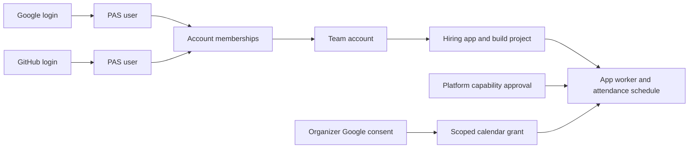

# Team accounts and app ownership

Status: **Proposed design, not an accepted policy or deployed feature.** Investigated 4 November 2026 against platform `1f461fa07fbb2620747075b4729e699382508cef`, current `origin/main` at investigation time; Creator Console `df1a9ef`; Hiring `938a644`. See the [implementation plan](team-accounts-implementation.md) and [source inventory](team-accounts-source-inventory.md).

PAS should let a personal account or a team account own an app. People authenticate individually and receive permissions through memberships. Runtime eligibility belongs to the owning account and app, subject to platform approval; it must not depend on which login provider the original creator used.

The existing system supports collaborators on individual apps. It does not yet provide a shared ownership and billing account. Adding a Teams page or changing one worker permission check would leave inconsistent ownership in agent projects, build tools, provisioning, and connected services.

For Hiring, the intended outcome is a team-owned app that both of the user's existing Google and GitHub identities can administer, with an explicitly approved attendance worker. The two identities need not be merged to achieve that outcome. Calendar access remains a separate grant from the organizer. This design does not authorize an ownership transfer, a capability approval, an invitation email, or a new OAuth grant.

## 1. Findings and evidence

The source inventory is a lexical impact scan, not a claim that every match is an authorization defect. It found 270 ownership/permission references in 56 backend files and 84 references in 21 files across the other scanned services. Some matches are comments, historical attribution, or generated documentation. The important behavioral findings below were checked against implementations.

| Area | Current behavior | Design implication |
|---|---|---|
| Login identity | OAuth creates `gh:<id>` or `google:<sub>` user rows. Signing in through another provider can create a separate PAS user. | Team membership must work across providers; automatic identity merging is unnecessary and unsafe. |
| Ownership | `apps.creator_id` is the current owner. Transfer/recovery changes that field. | Introduce an owning account separate from the person who created the app. |
| Collaboration | `team_members` and `team_invites` are scoped to an app. Roles are viewer, po, developer, admin, owner. | Reuse the concept of app assignments, but add account membership and lifecycle. |
| Permissions | `requireAppAccess` accepts creator, app member, or platform-admin session. Many routes call the owner-only alias. | Define permissions by action and make all services use the same authority. |
| MCP builds | Project tools require effective owner. The provisioning workflow caches ownership for 60 seconds. | Developer access and immediate revocation need explicit redesign; don't merely broaden a helper globally. |
| Data workers | Direct SQL requires developer; migrations require owner, resolved through `/v1/apps`. | Maintain a distinct, highly privileged data permission; old workers need compatibility coverage. |
| Agent projects | D1 `agent_projects.owner_id` and ProjectDO `project.owner_id` are separate ownership copies. Agent execution resolves that owner's personal API key. | Migrate authority and funding together, including draft projects without an app. |
| Workers | Enablement requires an admin session and an app owner in `ADMIN_GITHUB_IDS`; deployment config specifies `loader` and a five-app cap. | Separate platform trust approval from personal ownership. Keep rollout controls until explicitly superseded. |
| Calendar | Credentials belong to a PAS user; app authorization and exact-calendar grants are separate. A publisher-change trigger revokes grants. | Team ownership must not silently acquire a person's provider credentials or retain stale publisher consent. |
| Billing | Personal Pro subscriptions, app buyer purchases/entitlements, and agent BYOK are different systems. | Team infrastructure billing must not rewrite app-customer or personal billing identities. |
| Payouts | Creator payout tables remain, but payout code is archived and `PAYOUTS_ENABLED` is permanently false. | Do not revive Stripe Connect or revenue payouts as part of teams. |
| Console | Directory distinguishes owned/team/operator apps; source has no complete account switcher and team account management flow. | Add an account workspace and an explicit distinction between publisher permissions and app users. |

Primary source anchors:

- Identity: [users schema](https://github.com/proappstore-online/platform/blob/1f461fa07fbb2620747075b4729e699382508cef/migrations/0021_users.sql), [OAuth callback and profile handling](https://github.com/proappstore-online/platform/blob/1f461fa07fbb2620747075b4729e699382508cef/packages/backend/src/routes/auth.ts).
- Access: [app teams](https://github.com/proappstore-online/platform/blob/1f461fa07fbb2620747075b4729e699382508cef/packages/backend/src/routes/teams.ts), [permission helper](https://github.com/proappstore-online/platform/blob/1f461fa07fbb2620747075b4729e699382508cef/packages/backend/src/lib/auth.ts), [private visibility](https://github.com/proappstore-online/platform/blob/1f461fa07fbb2620747075b4729e699382508cef/packages/backend/src/lib/visibility.ts), [directory](https://github.com/proappstore-online/platform/blob/1f461fa07fbb2620747075b4729e699382508cef/packages/backend/src/routes/app-directory.ts).
- Ownership: [transfer implementation](https://github.com/proappstore-online/platform/blob/1f461fa07fbb2620747075b4729e699382508cef/packages/backend/src/routes/ownership.ts), [shipped ownership contract](app-ownership.md).
- Build surfaces: [build-core owner check](https://github.com/proappstore-online/platform/blob/1f461fa07fbb2620747075b4729e699382508cef/packages/build-core/src/ownership.ts), [MCP project tools](https://github.com/proappstore-online/platform/blob/1f461fa07fbb2620747075b4729e699382508cef/packages/mcp/src/project-tools.ts), [MCP ownership cache](https://github.com/proappstore-online/platform/blob/1f461fa07fbb2620747075b4729e699382508cef/packages/mcp/src/provisioning-workflow.ts), [raw data authorization](https://github.com/proappstore-online/platform/blob/1f461fa07fbb2620747075b4729e699382508cef/packages/data-worker/src/index.ts).
- Agent projects: [router](https://github.com/proappstore-online/platform/blob/1f461fa07fbb2620747075b4729e699382508cef/packages/agent-teams/src/index.ts), [DO access](https://github.com/proappstore-online/platform/blob/1f461fa07fbb2620747075b4729e699382508cef/packages/agent-teams/src/project-access.ts), [route roles](https://github.com/proappstore-online/platform/blob/1f461fa07fbb2620747075b4729e699382508cef/packages/agent-teams/src/role-gate.ts), [BYOK resolution](https://github.com/proappstore-online/platform/blob/1f461fa07fbb2620747075b4729e699382508cef/packages/agent-teams/src/byo-key.ts).
- Compute: [worker enablement](https://github.com/proappstore-online/platform/blob/1f461fa07fbb2620747075b4729e699382508cef/packages/backend/src/routes/app-workers.ts), [deployment configuration](https://github.com/proappstore-online/platform/blob/1f461fa07fbb2620747075b4729e699382508cef/packages/backend/wrangler.toml), [ADR-009](adr/009-app-workers.md).
- Connections: [Calendar schema and revocation trigger](https://github.com/proappstore-online/platform/blob/1f461fa07fbb2620747075b4729e699382508cef/migrations/0123_google_calendar_connector.sql), [Calendar account handling](https://github.com/proappstore-online/platform/blob/1f461fa07fbb2620747075b4729e699382508cef/packages/backend/src/lib/google-calendar-accounts.ts), [PAGS app binding](https://github.com/proappstore-online/platform/blob/1f461fa07fbb2620747075b4729e699382508cef/packages/backend/src/routes/pags.ts).
- Money: [personal subscription routes](https://github.com/proappstore-online/platform/blob/1f461fa07fbb2620747075b4729e699382508cef/packages/backend/src/routes/subscription.ts), [app billing](app-billing.md), [app revenue ledger](https://github.com/proappstore-online/platform/blob/1f461fa07fbb2620747075b4729e699382508cef/packages/backend/src/lib/billing-ledger.ts), [archived payout flag](https://github.com/proappstore-online/platform/blob/1f461fa07fbb2620747075b4729e699382508cef/packages/backend/src/lib/payouts-flag.ts).
- Console snapshot: [directory](https://github.com/proappstore-online/console/blob/df1a9ef/web/src/DirectoryView.tsx), [profile](https://github.com/proappstore-online/console/blob/df1a9ef/web/src/ProfileView.tsx), [app creation](https://github.com/proappstore-online/console/blob/df1a9ef/web/src/NewAppModal.tsx).

### The Hiring incident

The existing chat connection reported the GitHub identity. A fresh official Codex-managed MCP connection reported the intended Google identity and `ownership_status(hiring)` returned `you: owner`. Thus the observed repeated-login problem was retention of the older connection, not evidence that PAS had authenticated Google as GitHub. The exact host cache mechanism was not inspected.

The worker refusal is explained separately by the documented prototype owner check. Google ownership is valid; it is not a broken app registration. No ownership change was executed. The existing recovery request remains a separate pending administrative workflow.

### Additional gaps that matter for this feature

1. Existing app team invites are bearer links. An optional email is a delivery address; acceptance does not bind the invite to that email. Reuse the invite lifecycle, not this recipient policy, for team-account invitations.
2. Direct member addition understands GitHub names and existing canonical team IDs; it does not provide general verified Google-user discovery. New invitations must be provider-neutral and avoid disclosing whether an email has an account.
3. `googleProfile` stores the email but does not persist the `email_verified` claim. Email-targeted invitations require explicit verification provenance or PAS email proof; existing email strings are insufficient.
4. Current ownership transfer updates the app registry and transfer/audit rows. The inspected operation does not update ProjectDO ownership, personal BYOK funding, or GitHub collaborator grants. A team migration must reconcile these rather than assume they follow automatically.
5. A platform admin, an app collaborator with an admin role, and an application user such as a Hiring recruiter are different authorities. Team accounts must preserve that separation.
6. Historical comments mention payouts and some issue descriptions mention PR delivery. Current payout code and current repository instructions take precedence: payouts remain disabled; delivery stays directly on main through the runner router.

## 2. Scope and product model

Use **Team** in the UI and `account` in the control-plane model. An account has `kind: personal | team`. Avoid overloading “Agent Teams,” which means autonomous build agents, and avoid a second nested group hierarchy in the first release.

| Concept | Meaning | Owns or controls |
|---|---|---|
| User | A stable PAS principal; existing user IDs remain valid | Personal login sessions and personal consent |
| Login identity | A provider and immutable subject mapped to a user | Authentication only |
| Personal account | A resource owner controlled by one user | Apps, draft projects, optional infrastructure billing |
| Team account | A resource owner with multiple members | Apps, projects, team funding configuration, runtime eligibility |
| Account membership | A user's relationship to the account | Governance and which app assignments can take effect |
| App assignment | A user's role on one app or draft project | App administration and development capabilities |
| App user role | A role in an app's business workflow | Recruiter/moderator/customer actions, not publisher ownership |
| Workload identity | Platform-attested app, CI workflow, or agent run | Narrow automation permissions, never a human owner's full session |
| Provider connection | A person's or explicitly supported organization's external authorization | Only the resources and operations explicitly granted |



In the first release, both existing user records can join the same team. A shared password or a fake “team user” is never created. An account is not a login session.

Included: personal-account migration, team creation and invitations, member lifecycle, app/project assignment, ownership transfer, permissions across services, account-aware provisioning, runtime eligibility design, connector and funding continuity, Console/CLI/MCP support, audit and rollout controls.

Deferred: merging populated user accounts; SAML/SCIM; domain-based auto-join; nested groups; arbitrary custom roles; automatic GitHub organization import; team-wide access to every personal connector; new seat pricing; a payout marketplace. These are not prerequisites for Hiring.

## 3. Permission model

### Account roles

| Role | Account administration | Apps | Money and trust |
|---|---|---|---|
| Owner | Settings, invitations, owner promotion, member removal, deletion and account recovery participation | Full publisher control; transfer apps in/out | Manage team funding and limits; may request runtime access but cannot approve platform trust |
| Admin | Settings and ordinary members; cannot manage owners or peers | Manage account apps, creation, assignments and publishing | Cannot change payment method, raise account spending ceiling, transfer ownership or approve runtime access |
| Billing manager | Billing contact, statements, payment method and approved budget settings | No code, production data, connector or membership access | Cannot start agent jobs, grant app roles or enable a platform capability |
| Member | Own profile and limited account information | Only explicitly assigned apps | No account funding or trust administration |
| Guest | Own membership; no general directory or member list | Only explicitly assigned apps; cannot create apps | No account governance or billing |

Owners and admins have account-wide publisher access. If a company needs isolated departments, use separate team accounts in v1. Do not imply an account owner is excluded from production data when they can change the code that accesses it.

Personal accounts have one immutable owning user and no account-level co-owners. Their existing collaborators become app-scoped guests, without gaining visibility into the user's other apps or finances.

### App roles and explicit permissions

Retain the familiar app roles, but replace rank comparisons with named permission sets. Product work and financial work are not a single privilege ladder.

| Action | Owner | Account admin | App admin | Developer | Product owner | Viewer | Billing manager only |
|---|---|---|---|---|---|---|---|
| App metadata, source and sanitized operational views | Yes | Yes | Yes | Yes | Yes | Yes | Billing summary only |
| Tickets, requirements and specifications | Yes | Yes | Yes | Yes | Yes | Read | No |
| Source changes and normal deploy | Yes | Yes | Yes | Yes | No | No | No |
| Arbitrary SQL and schema migration | Yes | Yes | Yes | Only explicit `data.manage` grant | No | No | No |
| Secret configuration, connector bindings, webhook configuration | Yes | Yes | Yes | No | No | No | No |
| Run/pause build agents within an approved budget | Yes | Yes | Yes | Yes | No | No | No |
| App assignments | Yes | Yes | Limited to current account members and lower app roles | No | No | No | No |
| Storefront publication and domains | Yes | Yes | Yes | No | No | No | No |
| Account spending ceiling/payment method | Yes | No | No | No | No | No | Yes |
| App transfer, app deletion, team deletion | Yes | No | No | No | No | No | No |
| Platform runtime approval | Platform operator only | No | No | No | No | No | No |

An account member or guest with no assignment gets none of the app-role capabilities above. Billing access is additive and not obtained by becoming an app developer. The product-owner role finally has an explicit, useful non-code permission set.

**Compatibility:** existing developers already have arbitrary SQL access. Backfill an explicit `data.manage` grant only for those existing assignments, record the reason `legacy_developer_data_access`, and show it in the migration preview. New developer assignments do not receive it by default. Existing app `owner` rows become an `app_legacy_owner` compatibility permission bundle; they retain their existing app management powers but do not become account owners or acquire transfer authority that the current creator-only transfer route never granted. Document and test the bundle before cutover.

A person allowed to edit and deploy production code is trusted with the data and connector operations available to that code. Hiding plaintext secrets in the UI does not remove that trust. Sensitive deployments may later require a separate approval workflow; the first release must describe the actual access clearly.

### One decision function

Implement `authorize(principal, resource, action, context)` in the backend authority. It returns a decision, reason code, account/app versions, and safe effective-permission metadata. Export action names and role maps from a small workspace library; service-bound checks remain authoritative.

Evaluation order:

1. Validate the credential, its audience/resource binding, and active principal. A user ID supplied by the client is never an identity proof.
2. Resolve the app/project and its owning account. Explicit account IDs select a workspace; they do not grant access.
3. Deny suspended/deleting accounts and blocked resources, except narrowly named recovery, billing-resolution, or audit-read actions.
4. Resolve live account membership and app assignment. Removed memberships and expired grants do not contribute permissions. Unknown roles deny.
5. Check the specific action, environment, and any recent-authentication requirement.
6. Apply platform capability approval, quotas, funding and connector-grant checks independently.
7. Record the decision where required and perform the mutation with version/permission guards at its authoritative commit point.

Team governance requires a first-party control-plane audience or an explicitly granted account-management MCP scope. Ordinary app-origin sessions, end-user personal app tokens and app-bound MCP connections cannot administer accounts merely because the person behind them owns a team. Apply the same credential-scope intersection to publisher source writes, deploys and raw-data administration: a person's team rights must not give a credential issued to an unrelated app access to all team apps. Introduce the required audience/scope checks and supported broker flow before enabling these routes; do not assume existing session claims already provide that separation. A legacy MCP grant retains its existing scope; adding account-governance authority requires a supported, user-reviewed consent upgrade rather than silent scope expansion. Session refresh rechecks credential status, and live membership remains authoritative rather than embedding durable team permissions in JWTs.

Maintain two scopes: publisher/control-plane permissions and business/end-user app roles. Becoming a team member does not automatically become a Hiring recruiter or grant end-user purchases. Update private-app visibility deliberately to recognize publisher access without copying it into `app_roles`.

### Revocation and cached authority

Membership changes increment `accounts.authz_version`; ownership changes increment `apps.ownership_version`; app assignment changes increment `apps.access_version`. Mutating operations recheck live authority, including all version expectations, immediately before their authoritative write. Do not accept a 60-second cached allow for source writes, transfers, deploys, data operations, connector changes or spending.

Metadata reads may use a maximum ten-second cache keyed by user, resource and versions. Private data reads use live authority. WebSockets recheck on each privileged message, receive removal notifications and disconnect when revoked; a heartbeat limits stale read-only streams to ten seconds. A check requiring the latest state uses the D1 primary; an unavailable authority fails closed.

An external GitHub write or provider API call cannot be made atomically with D1 membership removal. Serialize dispatch of sensitive external operations against revocation through a resource-operation coordinator, and define the boundary: operations admitted before removal may finish; operations admitted after removal must fail. Record operation admission and completion separately. Never promise to retract data already returned or an outbound request already sent.

Platform operator powers stay separate from account ownership. Ordinary team owners do not get a platform `admin` role. Support access should be explicit, reasoned and audited; any move from today's broad admin behavior is a separately tested compatibility change. No app-controlled origin may obtain a platform-administrator credential through this work.

## 4. Data design

These are proposed tables/columns, not executable migrations. Allocate migration numbers only when implementation starts. Use immutable generated IDs, UTC millisecond timestamps, foreign keys where deletion semantics are safe, indexed lookups, and CHECK constraints for enums.

| Table or change | Key fields and invariants |
|---|---|
| `accounts` | `id`, `kind`, `name`, unique normalized `slug`, `status`, `personal_user_id`, `created_by`, `authz_version`, `governance_version`, timestamps. Personal kind requires one unique `personal_user_id`; team kind requires NULL. |
| `account_memberships` | PK `(account_id,user_id)`, `role`, `status`, `generation`, `created_by`, timestamps. Roles and statuses checked. At least one active owner for each active team. |
| `account_invitations` | `id`, account, target user OR verified email target, requested role, inviter, hashed token, expiry, status, version, accepted-by. Never store a reusable raw invite token. |
| `app_access_grants` | App, user, role/explicit permission bundle, membership generation, grantor, expiry, revoked-at. For team apps, an active account membership of the matching generation is mandatory. |
| `apps` additions | `owner_account_id`, `ownership_version`, `access_version`, `authorization_model`. Keep `creator_id` as legacy/historical attribution after cutover; stop using it for authority. |
| `agent_projects` additions | `owner_account_id`, ownership/version fields and funding reference. The D1 row is authoritative even for drafts; DO state is a versioned projection. |
| `account_app_transfers` | App, source/target accounts, initiating/accepting users, expected owner and access versions, preview hash, state, expiry, operation ID. |
| `account_capabilities` | PK `(account_id,capability)`, state, rollout cohort, limits, approving platform actor, reason/evidence reference, version and expiry. Account members cannot write approvals. |
| `app_runtime_approvals` | Per-app approval and reviewed policy/provenance version. Retain enable/disable and existing account-wide worker cap; this does not replace app runtime status. |
| `account_billing_profiles` | Account-to-Stripe customer mapping, billing contact, billing mode and status. Unique customer ownership within this product domain; never inferred from a member's email. |
| `account_funding_sources` | Encrypted team BYOK references or explicit personal sponsorship grants; provider, owner, allowed projects, ceiling, status and version. Secret bytes remain in the vault. |
| `account_workload_grants` | Account, app/project, trusted workload/provider subject, allowed actions, environment, repository/workflow/ref constraints where relevant, authority versions, expiry and revocation. Extend existing workload tables where their semantics already fit instead of creating a second authority. |
| `account_usage_reservations` | Account, app, run/operation, period, reserved/settled quantities and status. Unique idempotency key; accounts and app quotas both apply. |
| `account_audit_events` | Append-only account/app, actor, authenticated identity/workload, action, target, versions, request/operation ID and redacted details. Preserve events after soft deletion. |
| `account_operations` + outbox | Idempotency key scoped to actor/account/action, payload hash, status, result reference; durable side effects keyed by operation and effect. |
| `user_verified_emails` | User, exact normalized email, verification method, verified-at, revoked-at. No “verified” backfill based only on a stored email or provider label. |

Minimum indexes: memberships by `(user_id,status,account_id)`; grants by `(app_id,user_id)` and `(user_id,revoked_at)`; apps/projects by owning account; invitations by token hash and pending target/account; transfers by app/status and target/status; audit by account/time and app/time; outbox by state/next-attempt; usage by account/period.

Avoid destructive cascades over the audit or financial ledger. Account deletion is a stateful operation, not `DELETE accounts` followed by cascades. Deleting the final owner or demoting two owners concurrently must be impossible at the database write boundary. Account creation inserts a non-active account, its first owner, and its active state in one guarded batch so the invariant also holds at creation.

### Atomic changes and side effects

Use conditional SQL and a single D1 batch for membership/owner changes, version increments, the operation receipt, and audit/outbox insertion. D1 batches roll back on a statement error, but an UPDATE affecting zero rows is not an error. A guarded write must either drive every subsequent statement through the same operation marker or explicitly raise a constraint failure. Inspect the result and return `409 stale_state` without audit events claiming success. Cloudflare documents the batch transaction behavior in its [D1 API reference](https://developers.cloudflare.com/d1/worker-api/d1-database/).

Email, GitHub membership changes, DO projections and provider revocation happen through retryable outbox effects after commit. A timeout must not cause a duplicate membership or transfer. Retried identical operation IDs return the recorded result; reused IDs with different payloads return 409.

## 5. User journeys and API contract

### Create and switch accounts

The Console account menu lists Personal and joined teams, with the signed-in identity visible independently. Creating a team asks for a name; the creator becomes its first owner. V1 team creation/ownership requires a verified supported human login; app-bound credential/child accounts and test/workload principals cannot become team owners. App and project creation explicitly identify the owning account. The last-used account is a UI preference only, stored per user; a stale tab cannot silently create an app under a different account.

App headers show “Owned by [team]” and “Your access: [role]”. Settings separate Team members, App access, App users, Billing, Connections and Runtime. The current identity is also visible in MCP `whoami` and CLI status. A reconnect can change identity without implying a change to account ownership.

### Invite, promote and remove

Email invitations bind to a freshly verified email; exact-user invitations bind to a canonical PAS user ID. Each invitation is single-use, seven-day expiry, revocable, rate-limited and audited. V1 has no general bearer “anyone with the link joins the team” invite. Do not normalize Gmail dots or plus aliases into identity equivalence.

The acceptance page shows the team, inviter, proposed role and current identity before approval. A wrong identity cannot consume the invitation. Put the invitation secret in the link fragment, remove it from browser history after reading it, submit it in the preview/accept body, and use no-referrer/no-store responses. Recheck the inviter's current authority, target status, role ceiling, account status and invitation version in the accepting transaction. A revoked inviter cannot leave usable invitations behind. Owners promote existing verified members to owner with recent authentication; ordinary admins cannot invite or promote owners.

Removing a member revokes their account grants, app assignments, pending invitations issued under that authority, and personal sponsorships bound to membership. Rejoining creates a new membership generation and never resurrects old assignments. The removal preview lists affected apps, direct GitHub access, personal connectors, agent funding and active jobs. Shared account-owned workloads continue if they no longer depend on the departed member; user-authorized jobs are stopped at their next authorization boundary.

### Move an app into a team

Transfer remains an offer and acceptance, now between owning accounts. A source owner initiates; a target owner accepts. The same human can hold both roles, but still reviews and confirms the target context explicitly. Team creation never imports all personal apps automatically.

Preview includes: source/target account; effective people gaining/losing publisher access; app/project/repo/route/data locations; pending invites; raw-data grants; runtime eligibility; schedules/queued runs; provider grants; funding; CI and repository access; active app purchases; and the treatment of legacy requests. Hash the material preview and bind confirmation to app/account versions. Recompute on acceptance; material changes require a new preview.

States: `pending → accepted | declined | cancelled | expired`, with `escalated` recovery and an explicit administrative resolution. Use the existing seven-day offer convention. The accepted state changes D1 ownership atomically, increments versions, closes obsolete offers/recoveries, invalidates affected grants, and creates a reconciliation operation. Expose `reconciling` versus `ready`; don't claim side effects finished just because D1 committed.

Published URLs, app IDs, repositories and D1 databases stay in place. No copying of business rows. Historical audit actors, creator attribution, purchases, invoice references and deployment provenance remain historical. Existing app collaborators are mapped in a preview; the source owner is not retained as a guest silently.

Pause new agent starts, privileged deploys and scheduled connector work during the transition. A publisher change revokes personal connector grants by default, including when an individual moves their app into a team they own. Resume only after target funding, access reconciliation and required reconsent succeed. This is a deliberate, visible transition rather than a claim of zero interruption for background work.

### Proposed API surface

All routes below are proposals under `/v1`. First-party clients authenticate through supported connections; this design does not introduce model-visible tokens. Account/app metadata for inaccessible resources remains non-enumerating. Responses use no-store for identity, invitations, permissions and transfer previews.

| Route | Purpose and minimum authority |
|---|---|
| `GET /me/accounts` | List caller memberships and personal account |
| `POST /accounts` | Create a team as verified user, with idempotency key |
| `GET/PATCH /accounts/:id` | Read permitted metadata / update settings as admin or owner |
| `GET /accounts/:id/members` | Member management view, limited by account role |
| `POST /accounts/:id/invitations` | Owner/admin proposes permitted role; sending is a distinct disclosed side effect |
| `POST /invitations/:id/preview` | Read-only authenticated recipient preview with link secret in the body, never broad account disclosure |
| `POST /invitations/:id/accept` | Intended verified recipient; secret in body, not persistent browser storage |
| `POST /accounts/:id/invitations/:iid/revoke` | Authorized inviter/admin under current role rules |
| `PATCH/DELETE /accounts/:id/members/:uid` | Role change/removal with expected membership/account versions |
| `GET /apps/:appId/access` | Caller permissions, owner-account summary, safe reason codes |
| `PUT/DELETE /apps/:appId/access/:uid` | App assignment management with live membership checks |
| `GET /accounts/:id/apps` | Only caller-accessible apps; no existence leak to guests |
| `POST /apps/:appId/ownership/preview` | Read-only material transfer preview |
| `POST /apps/:appId/ownership/offers` | Source owner creates offer with preview hash and expected versions |
| `POST /ownership/offers/:id/accept` | Target owner, fresh preview and recent authentication |
| `GET /accounts/:id/capabilities` | Safe eligibility state and request guidance |
| `POST /accounts/:id/capability-requests` | Owner requests access; does not enable anything |
| `PUT /admin/accounts/:id/capabilities/:name` | Platform approval with evidence, audit and recent authentication |
| `GET /accounts/:id/audit` | Paginated, role-filtered audit; bounded date range and export |
| `POST /accounts/:id/deletion-preview` | Owner lists blockers and consequences |

Example denial: `{ error: { code: "runtime_approval_required", account_id, capability: "app_workers", request_allowed: true }, request_id }`. Distinguish `membership_removed`, `permission_missing`, `recent_auth_required`, `stale_state`, `funding_required`, `account_suspended` and `quota_exceeded`. Never suggest switching Google/GitHub identities as the generic fix.

MCP gets `list_accounts`, `account_info`, `list_account_members`, invitation/member tools, account-aware provisioning/ownership tools and `capability_status`. Mutating tools preserve the platform's dry-run/confirmation convention and disclose communications. CLI gets `pas account list/use`, `pas team ...`, and explicit `--account` for creation; a default workspace is printed in previews. SDK adds first-party account management APIs and a narrowly scoped access-summary API, without teaching ordinary apps to administer publisher teams.

Keep old routes during migration. They resolve through the same permission authority and preserve old response fields where safe. For team-owned apps, old clients requesting creator-only transfer semantics receive an explicit upgrade-required response; they never fall back to the historical creator.

## 6. Runtime eligibility and scheduled work

Three independent checks must all pass:

```text
actor/workload may perform this action
AND owning account and app have platform-approved runtime eligibility
AND runtime state, budget, quotas and required provider grants permit it
```

An account owner is not a platform administrator. Paying a subscription does not establish runtime trust. An approved runtime capability is not permission to read another app's data.

**Pilot recommendation:** replace the individual-admin-owner heuristic with explicit, platform-reviewed account/app eligibility for a tightly controlled pilot. Keep the existing loader backend, five-app cap, admin enable switch, egress enforcement, per-invocation limits, app quotas and suspension controls. This requires a separately accepted amendment to ADR-009; this document does not lift its rule.

An approved team may add untrusted developers, so marking the account “first party” once is insufficient. Bind pilot approval to reviewed publishing principals/workload grants and `governance_version`, separate from the broader `authz_version`. A change to owners, production publishers, deploy authority, repository trust or funding can mark runtime approval `needs_review` and prevent new deployments/starts until reviewed. Ordinary non-publisher changes need not suspend a running app. An unreviewed collaborator must not submit code through an approved CI identity as a loophole; the pilot needs a controlled production branch and authorized deployment admission.

Check eligibility at enablement, deploy admission, event admission, and privileged RPC use. Transfer or suspension cannot leave an already-enabled worker operating under an obsolete decision. Keep internal app credentials app-scoped; rotate them and increment runtime configuration/version when authority crosses a publisher boundary.

General availability remains a separate decision. [ADR-009 §6](adr/009-app-workers.md) requires operational evidence, secret isolation, egress/runtime limits, cross-app tests, a rotation drill and quotas. Existing implementations/tests and closed issues are evidence of shipped components, not proof that all live exit criteria have held. The worker epic [#251](https://github.com/proappstore-online/platform/issues/251) and retirement task [#263](https://github.com/proappstore-online/platform/issues/263) remain open at investigation time. Do not treat stale checklist text as current measured production state.

Schedules run as the app workload, not the owner or whoever last logged in. Store account/ownership versions on queued work and recheck before dispatch and sensitive platform calls. Keep run IDs/idempotency and failure-versus-absence semantics from the existing attendance implementation. Suspended eligibility, revoked Calendar consent or insufficient budget records an explicit blocked result, never candidate non-attendance.

## 7. Connections and identity linking

### Personal consent and team use

A provider connection has a credential owner; an app receives a scoped use grant. Team administrators may manage the app binding and see consent health, but cannot view the refresh token or automatically reuse the person's other accounts/calendars.

For the first release, preserve the Calendar connector's per-user account, per-app consent and exact-calendar grant. Add publisher account/version and grant purpose metadata. Hiring keeps its own brand/event authorization and consent checks; moving the publisher account does not make all team members recruiters or expose all brand calendars.

Distinguish grants created by a publisher member for team operations from grants created by an app end user. Removing a publisher member revokes the former, using recorded membership generation. It must not revoke unrelated end-user grants merely because the same person once collaborated on the code. Conversely, removing a recruiter inside Hiring must still revoke or stop the corresponding brand use through Hiring's own authorization lifecycle.

On publisher transfer, revoke every personal app grant under the existing conservative rule and require reauthorization. A schema-only migration to the same user's personal owning account is not a publisher change and must not trigger revocation. Replace the `creator_id` trigger with owner-account/version semantics before team transfers are allowed.

Personal sponsorship or Calendar reauthorization is always performed by the credential holder through the supported consent flow. A team-owned Google Workspace installation would need its own explicit connector type and authority model; a team account does not grant domain-wide delegation.

PAGS subscriptions/private instances keep their own ownership. PAS account membership must not be treated as proof of authority over a PAGS instance. Preserve the verified platform integration, use an explicit app-instance binding and provider-approved delegation where available, and report unsupported team delegation instead of copying provider credentials. The attendance scheduler remains PAS app code; no additional PAGS agent is needed for the deterministic hourly job.

### Login identity linking is a separate workstream

Do not delay teams for account merging. Existing Google and GitHub users can both join a team as separate members.

A later `user_login_identities(provider, subject, user_id, status, linked_at)` table can allow multiple login methods for one stable user. Preserve all existing `users.id` values; never mass-rewrite app databases, personal tokens, purchases, passkeys or audit actors. Use the provider's immutable subject rather than email as the identifier, as required by [Google's OpenID Connect documentation](https://developers.google.com/identity/openid-connect/openid-connect).

Linking requires recent authentication to the current user and fresh proof of the new provider identity. An identity already attached to another populated PAS user produces a conflict and a separate reviewed consolidation workflow; it is not silently moved or unioned. Do not combine memberships, purchases, passkeys, personal vault entries or administrator rights by matching emails. Unlinking cannot remove the final usable login method and revokes affected sessions/grants.

In particular, linking a Google login to a user with historical GitHub administrator status must not automatically make that login a platform administrator. Platform elevation needs an independently enforced trusted authentication policy. Normal team governance works without any such elevation.

## 8. Billing, funding and limits

Keep four domains explicit:

| Domain | Owner and treatment |
|---|---|
| Personal PAS Pro subscription | Remains attached to the individual; never becomes a team plan implicitly |
| Team infrastructure subscription/usage | New account-scoped billing profile, introduced only with approved prices and billing behavior |
| Purchases made by Hiring's customers | Remain app/buyer/product/subject scoped; receipts and entitlements are not rewritten by publisher transfer |
| Agent build spending | Explicit account-owned BYOK or personally approved, revocable sponsorship with account/project limits |

V1 team ownership can launch with billing mode `manual`/`not_configured`; it must display this honestly and refuse spend requiring an unfunded source. Do not invent seat charges or silently charge a member's card. The existing app-product billing admin enable switch remains separate.

For agent projects, replace implicit `project.owner_id → personal vault` lookup with `project → account → funding grant`. Team BYOK is encrypted in the existing vault infrastructure and resolved only by the authorized run. A personal sponsor explicitly chooses projects, ceiling and expiry. Departure/revocation stops new starts using that source. An app transfer pauses the agent loop until the destination confirms funding; it never charges the old owner automatically.

Per-app runtime quotas remain. Add an account aggregate ceiling so creating many apps cannot multiply an account's allowance. Reserve budget before dispatch, settle actual usage idempotently, and release abandoned reservations through a bounded reconciliation job. Tag each new usage event with app, owning account at the time, initiating actor, workload/run and funding version. Historical spend is never reassigned when an app moves. Where old records lack enough ownership history, retain legacy attribution or mark it unknown; do not reconstruct the payer from today's owner.

Owners/billing managers can adjust their account's chosen budget only within platform-approved ceilings and the funding owner's sponsorship limit. They cannot raise platform quotas or another person's sponsorship by editing a budget. Payment cancellation/suspension blocks new billable work according to the applicable plan policy, while allowing owners to inspect billing and resolve the problem. Detailed prices, taxation and commercial terms require their own product decisions; this feature does not implement them. Archived payouts and Stripe Connect stay disabled.

## 9. Migration and compatibility

### Phase A: additive foundation

Add account and permission tables, nullable owner-account columns and version fields. Existing code remains functional. Backfill one personal account for each distinct owning user, plus draft-project owners; lazily create one for other users when needed. Use deterministic mapping records and idempotent batches. Never merge users by email.

Populate app/project owning-account references and map existing app members as app-scoped guests with compatible rights. Preserve current IDs, app data, purchases, subscriptions, user grants and original provenance. Inventory orphan creators, mismatched app/project owners, duplicate provider subjects, role anomalies and pending ownership requests; quarantine exceptions rather than guess.

### Phase B: authority and projections

Implement the central permission authority and run it in shadow mode against old decisions for unchanged personal accounts. Classify every divergence; preserve intended rights and deny unintended expansion. Replace direct owner comparisons across the full inventory, including provisioning, app directory, private-app visibility, notifications, deletion, billing administration, raw data, MCP build tools, agents and admin provisioning guards.

Upgrade data-worker fleets and ProjectDO routers before enabling team-owned apps. Version the authorization protocol and make the gateway refuse team operations through incompatible services. ProjectDO owner fields become historical/projection fields; they may not authorize a prior owner after D1 ownership changes. Recheck active WebSockets and agent loops.

Projection delivery is at least once and monotonic by ownership version. D1 is authoritative; missing/stale DO state denies privileged work until repaired. Draft projects get the same account model as provisioned apps. Creation and provisioning receipts bind actor, account, intended app and owner version to prevent a retry under a different account.

Replace owner-only notification routing with explicit account/project notification subscriptions: billing notices go to owners/billing contacts, operational failures to subscribed permitted app operators, and security/removal/transfer notices to affected principals and owners. Re-evaluate recipients at delivery time. Do not broadcast candidate details, provider identifiers or job logs to every team member, and do not continue notifying a removed historical owner.

### Phase C: controlled team pilot

Enable team creation/invites and test transfers for selected accounts after all authorities recognize the model. Offer a migration preview for each app. Adapt existing personal-user transfer routes to account transfers; migrate or cancel pending requests with explicit status and audit. Do not apply an old recovery request against a newly team-owned app.

A transferred app no longer falls back to `creator_id` for any authorization. Retain that field for compatibility display/historical attribution until downstream consumers have migrated. Keep identity and account IDs in different types to prevent passing a team ID into `users`, an app's `:__user_id`, or a provider credential lookup.

### Phase D: reconciliation, rollout and rollback

Before enabling each pilot app, verify account/app permissions, DO projection, GitHub access, build funding, provider grants and runtime approval. Only then resume schedules and deployment. Reconcile progress visibly in Console and MCP.

Feature flags: `accounts_read`, `accounts_write`, `account_authorization`, `team_app_transfers`, `team_runtime_pilot`, each with cohort controls. Flags are deployment controls, not user authority. Record rollout metrics: mismatched decisions, denied-after-removal attempts, projection lag, unresolved side effects, grant revocations, blocked schedules and billing reconciliation discrepancies.

Before the first team transfer, rollback can disable new UI/write paths while personal behavior remains. After team ownership exists, rolling back to binaries that authorize by `creator_id` is unsafe. The rollback target must retain account-aware enforcement; disable new transitions, suspend affected mutations/compute if necessary, and repair forward. Never “restore service” by assigning team apps to their historical creator.

Database rollback uses verified backups/recovery procedures for incidents, not destructive down-migrations. Account ownership transfers themselves require a new authorized reverse transfer; rollback flags cannot silently reverse ownership.

## 10. Repository, CI and automation access

PAS membership and GitHub repository access are separate grants. A team removal is incomplete if the person can still push to the production branch. Build a reconciler for PAS-managed collaborator grants and distinguish them from external/manual access. A Google-only member can use authorized PAS build tools without fabricating a GitHub identity; direct GitHub access requires a verified linked GitHub identity or separately approved provider grant.

Transfer/removal previews show direct repository access and any unreconciled blockers. Revoke managed access through an outbox and recheck deploy admission against current account/app authority. A CI token proves repository/workflow/ref provenance, not that every contributor remains authorized. Use existing immutable repository IDs and permitted workflow/ref checks; production admission must also respect account policy and in-progress transfer suspension.

Human fallback deploys require named deployment permission and recent auth. CI uses narrowly scoped workload grants, not a team owner's long-lived session. Review legacy OIDC e2e-user grants and test principals on transfer; preserve historical mints but revoke grants that no longer fit the target policy. Test-principal privileges cannot acquire team ownership, invitation or platform approval rights.

New workflows use `ProAgentStore/runner-router/.github/workflows/router.yml@v1`; every other job depends on it and consumes its runner output. Public repos remain GitHub-hosted, private repos use the billing-aware router, and no org secrets are introduced. Platform deployments remain push-to-main; there is no local Wrangler release step in this plan.

## 11. Recovery, suspension and deletion

Team ownership recovery is not the old “I created this app under another login” flow. An active owner can invite another owner. If all owners are inaccessible, require a platform-reviewed recovery case with evidence, notification to existing owners, an audit trail, and separation between requester and approver. An admin cannot approve a recovery that grants ownership to themselves. A provider email match alone is insufficient proof.

Prevent the last owner leaving, deleting their identity, or being demoted while the team is active. Two concurrent demotions must not pass independent prechecks; use a transactional invariant. Recommend two distinct humans as owners; adding the same person's two logins improves convenience but is not independent ownership continuity.

Suspension immediately prevents new privileged actions and workload admissions and invalidates active authority versions. Retain a narrow path for billing resolution, appeals and permitted audit reads. Organization membership removal and app-end-user erasure are separate operations.

Team deletion requires an owner preview, recent authentication, no owned apps/projects, no active funding/billable work, and resolved billing obligations under the applicable policy. Soft-delete first, preserve audit and financial records under the platform retention policy, and schedule secret/grant cleanup with receipts. Do not cascade-delete Hiring's candidate records by deleting a publisher team. Global user deletion likewise requires disposition of personal/team ownership; the existing per-app user deletion API is not a substitute.

## 12. Validation and acceptance

Existing baseline tests run for this investigation: **81 passed across four suites** covering team routes, ownership routes, archived payouts and agent role gates. This confirms the inspected baseline; it does not validate the proposed implementation. No production schema, ownership or permission changes were made for this investigation.

Required implementation tests:

| Boundary | Acceptance evidence |
|---|---|
| Provider-neutral teams | Google and GitHub members can operate the same team through their own sessions; identical display names/emails grant nothing |
| Account isolation | A user in two accounts cannot use a stale tab, forged account ID or app ID to cross scopes |
| Role contract | Table-driven tests for every permission through API, MCP, CLI, data worker and Agent Teams; no tool-specific owner shortcuts |
| Invite lifecycle | Wrong identity, expired/revoked invite, removed inviter, role escalation, concurrent acceptance, replay and email-verification changes fail correctly |
| Ownership continuity | Concurrent owner removals/demotions cannot leave an active team ownerless |
| Revocation | Existing sessions, WebSockets, cached MCP decisions, queued jobs, caller grants and repository deploys obey the defined revocation boundary |
| Transfer atomicity | Accept/decline races, stale preview, duplicate commands, DB failure, notification failure and DO outage produce one truthful result |
| Transfer consequences | Old owner loses all publisher authority; app data/URLs stay; historical records remain; connectors/funding pause and reconcile |
| Runtime trust | Team ownership or payment alone never enables compute; governance changes cannot bypass pilot approval or cap/quota enforcement |
| Credentials | No personal Calendar token, GitHub credential or BYOK is copied to another person/account by membership or transfer |
| Money | Personal Pro and app-buyer entitlements remain correct; budget reservations are atomic and usage cannot be double-charged |
| Migration | Sanitized fixtures for every role, personal app, team app, orphan, draft, pending transfer and old client; zero unexplained shadow differences |
| Fleet compatibility | Old data-worker/DO versions refuse new team authority safely; stale creator fallback cannot reappear on rollback |
| UX | Mobile/desktop account switch, invite wrong-account recovery, accessible role tables, transfer preview, revocation status and blocked-runtime explanation |

Run real D1/workerd concurrency tests for transactional claims; mocks cannot prove these invariants. Add cross-app and cross-account negative cases to runtime CI, plus Chromium/WebKit Console journeys. Test public/private runner routing remains unchanged. Before each implementation commit, run the repository-required checks; the docs-only design needs link validation and a docs build, not a speculative production migration.

Hiring acceptance after implementation: the Google identity and `serge-ivo` have deliberate membership in the chosen team; the team owns Hiring; an authorized platform operator has approved the team/app runtime; an organizer grants the selected Calendar/Meet access; a known ended meeting produces correct attendance; revoking consent produces a blocked/error result; removing a developer prevents further publisher access; existing candidates and brand permissions remain unchanged.

## 13. Decisions and alternatives

| Alternative | Assessment |
|---|---|
| Transfer Hiring to the GitHub admin identity | A possible immediate operational workaround, but leaves the platform tied to one login and needs a separately authorized transfer |
| Add the Google user to `ADMIN_GITHUB_IDS` | Grants platform-wide trust to solve one app's eligibility; not an appropriate team model |
| Add a `team_id` column and one role check | Insufficient: stale MCP/DO/provisioning authority, funding and provider consent remain |
| Share a team login | Loses individual attribution, independent revocation and safe consent ownership |
| Merge the Google/GitHub users first | Larger identity/data migration, unnecessary for teams, and still does not create a shared resource owner |
| Promote every app collaborator to team member with all-app access | Silently expands access; preserve app-scoped guest assignments instead |
| Automatically allow all paid teams to run workers | Violates the existing runtime rollout contract; payment is not an isolation or abuse-control test |
| Adopt a separate identity SaaS before building teams | Adds vendor and migration scope without resolving PAS's app/agent ownership copies; defer unless enterprise federation demands it |
| Personal/team accounts with centralized permissions | Recommended: preserves existing users and resources, separates governance from runtime approval, and supports incremental migration |

The proposed defaults are fixed roles, app-scoped guests, no automatic identity merging, explicit transfer consent, personal connector reconsent on publisher changes, explicit funding, and a controlled runtime pilot. The implementation plan names the policy decisions that need acceptance before rollout, without making those decisions implicit in code.

For Hiring, implement account ownership and cross-service authorization first, then migrate through the normal team-transfer flow. The runtime pilot decision can proceed as a separate reviewed workstream. Neither adding a member nor moving the app should be presented as a guarantee that workers will automatically become enabled.
