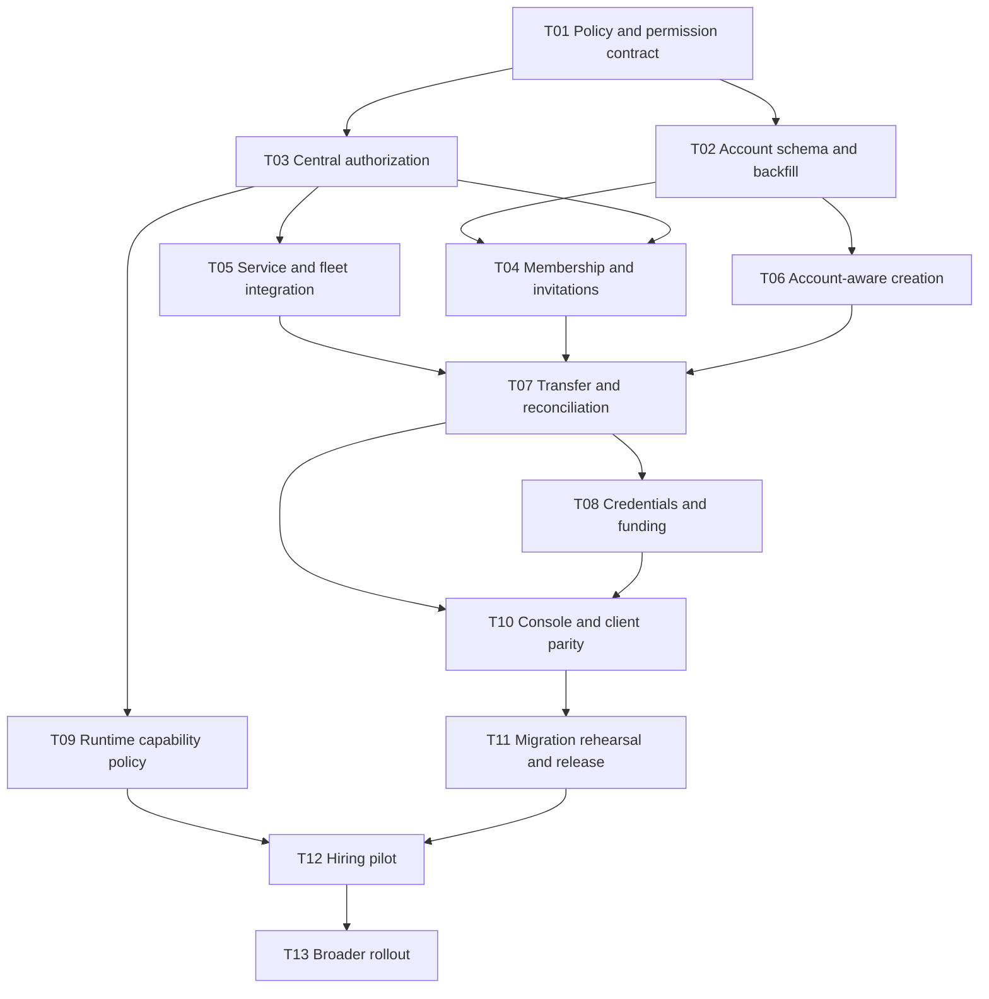

# Team accounts implementation plan

Status: proposed work breakdown accompanying the [team accounts design](team-accounts-design.md). These are planning IDs, not filed GitHub issues or approved production changes. The design is complete enough to split into implementation tickets; runtime policy, commercial terms and production migration require the decisions listed below.

## Delivery sequence

Some client work and test authoring can progress before the dependencies complete; the graph describes merge/enablement dependencies. Runtime general availability and existing-user identity consolidation are separate projects. Do not make a successful Google sign-in depend on either.

## Work packages

### T01 Adopt the account and permission contract

Deliver a proposed ADR for personal/team accounts and a specific ADR-009 amendment for any team runtime pilot. Define the permission list, role bundles, compatibility behavior, support elevation, account suspension and the external-operation revocation boundary. Do not allocate the next ADR number until checking the repository then-current sequence.

Files: new accepted ADR when approved; `docs/app-ownership.md`, `docs/app-workers.md`; a new small authorization-contract workspace package; backend `lib/auth.ts` call sites inventory.

Acceptance:

- Every current gate in the [inventory](team-accounts-source-inventory.md) is classified as live authorization, projection, historical attribution, provisioning actor or end-user business authorization.
- The app-role/permission matrix is represented as data shared by tests and documented without treating all roles as a numerical rank.
- The compatibility bundle for legacy app owners and developers has explicit rights and no account-wide expansion.
- Prototype runtime policy remains unchanged until the amendment is separately accepted.

### T02 Add account schema and migration tooling

Create the account, membership, invitation, app grant, operation and audit tables; add app/project account/version columns. Create a resumable dry-run backfill with per-row receipts and a count/hash report. Personal account IDs must have a stable mapping so concurrent provisioning or retries cannot create duplicates.

Files: new migrations; new `backend/lib/accounts/*`; provisioning persistence in `lib/provision-data.ts`, `lib/provision-operation.ts`; agent-project index migration.

Acceptance:

- Backfill personal apps and draft projects without changing `users.id`, database IDs, URLs, purchases, sessions or Calendar consent.
- Existing app collaborators become app-scoped guests; no access to other apps or account finances.
- Detect orphan owners, ambiguous provider subjects, app/project owner mismatches and unknown roles; output a remediation queue, not guessed assignments.
- New account-sensitive mutations use guarded SQL, idempotency records and immutable audit in one batch.
- Runtime tests prove concurrent last-owner removal/demotion and duplicate account creation are safe.

### T03 Implement authoritative permission decisions

Implement the action-based resolver, bounded access summaries, typed account/user/workload identifiers and live version checks. Introduce narrowly scoped control-plane credentials for account administration; do not give account-governance authority to a credential intended only for an app.

Files: `backend/lib/auth.ts`, new permission resolver/routes; `build-core` access client; session/credential validation at existing trusted boundaries.

Acceptance:

- Unit matrix for each action and account/app role; revoked/expired/unknown states deny.
- An arbitrary user/account/app ID in JSON cannot change the authenticated principal or effective scope.
- Existing end-user sessions, personal app tokens and app-scoped MCP grants cannot call team-governance operations.
- Identity is separate from selected workspace; switching UI accounts does not mint authority.
- Shadow decisions on personal-account fixtures match intended old permissions; every divergence has a reviewed classification.
- No cached positive decision authorizes a new privileged mutation after removal under the specified admission boundary.

### T04 Ship team membership and invitations

Implement team create/read/update, member lifecycle, targeted invites, self-leave, owner promotion and recovery entry points. Store email verification evidence. Build the operation outbox for email and access reconciliation.

Files: new backend account/team routes; existing `routes/teams.ts` compatibility adapter; auth email evidence; route/OpenAPI catalog; account audit and mail outbox.

Acceptance:

- Google/GitHub users join through their own identities without GitHub-only recipient resolution.
- Email is not auto-verified from historical rows or merged by alias normalization.
- Wrong-recipient, expired, already-used, revoked, concurrently accepted and stale-inviter cases are covered using real D1.
- Admins cannot grant owner or alter owners/peers; only owners can promote an existing member to owner.
- Guest/app-assignment generations prevent access resurrection after leave/rejoin.
- Email delivery retries cannot duplicate grants; safe redaction prevents invite secrets entering logs or analytics.

### T05 Integrate every authorization surface

Replace direct owner comparisons where they determine live access. Keep attribution fields historical. Update account-aware directory/list queries, private visibility, owner-only API routes, MCP source/build tools, data-worker authorization and Agent Teams.

Files: backend modules in the inventory; `build-core/src/ownership.ts`; MCP `project-tools.ts`, `provisioning-workflow.ts`; data-worker `index.ts`; Agent Teams router, `project-access.ts`, `role-gate.ts`, settings/reports, WebSocket handling; admin `provision-guard.ts`.

Acceptance:

- Developer source edits/deploy work through the same decision model on every supported client.
- Private-app access remains distinct from application business roles and purchases.
- Direct SQL and migrations require the designed permission; old client behavior is tested, not inferred from one backend unit test.
- Removed users cannot keep operating through MCP cache, DO owner fields, WebSockets, stale sessions or private-host paths.
- D1 account authority has no fallback to the old owner after cutover.
- Fleet audit reports each data-worker/DO protocol version; team ownership is refused until the affected services are compatible.
- Failed authority lookups deny; outage behavior and recovery do not silently broaden rights.

### T06 Make provisioning and draft creation account-aware

Pass authenticated actor and target owner account as distinct values through the creation workflow. Account ID is explicit for team creation; old clients default only to the caller's personal account. Bind account/versions into preview hashes, intent hashes, rate limits, receipts and workload claims.

Files: backend provisioning/plans/operation modules; admin provisioning guard and recording; build-core workflow; MCP provisioning tools; CLI create; Agent Teams project creation; Console new-app flow.

Acceptance:

- Two account tabs cannot cause a resource to be created under the wrong owner.
- Retrying an old creation receipt cannot move an app to a new account or restore historical ownership.
- Existing-resource adoption is separately authorized, regardless of a matching slug or GitHub repository name.
- Draft project membership and funding work before the app has an `apps` row.
- Account creation limits and app limits apply without changing public/private CI runner policy.

### T07 Implement app transfers and reconciliation

Reuse the offer/accept/recovery concepts, with account owners as parties and human actors in the audit. Add materially versioned previews, transaction guards and reconciliation state. Adapt legacy transfer/recovery requests explicitly.

Files: `routes/ownership.ts`, MCP ownership tools, migrations; Agent Teams projection updater; repository access reconciler; runtime/connector revocation hooks; transfer tests.

Acceptance:

- Source-owner and target-owner actions are individually authorized; platform admin cannot approve a recovery to themselves.
- Material preview drift yields 409 and requires a new preview.
- A single successful transfer changes authority exactly once; duplicate acceptance returns its recorded result.
- Old source owner and stale DO projections cannot operate after the transfer commit.
- Repo, URL, D1 and historical purchase identities stay stable; connector/funding changes appear explicitly.
- Protected operations remain suspended while required GitHub/DO/credential side effects are unresolved.
- Old pending recovery cannot execute against a new owning team; audit explains supersession.
- Existing-member and explicit source-owner-retention choices do not silently expand the destination's access.

### T08 Add connection and funding continuity

Bind provider grants to publisher account/version and purpose, while preserving the user's personal credential ownership. Add account funding sources and explicit personal sponsorship. Migrate Agent Teams away from resolving the historical owner's personal vault implicitly.

Files: Calendar migration/account/grant modules; connector registration and GitHub grant lifecycle; user vault resolution; Agent Teams `byo-key.ts`, `agent-runner.ts`, project settings; PAGS app-instance binding authorization.

Acceptance:

- Personal-account backfill preserves consent; actual publisher change revokes consent.
- Member removal revokes membership-bound operational grants and personal sponsorship but not unrelated app-end-user grants.
- A new team owner cannot inspect plaintext credentials, broaden a grant or spend a removed member's key.
- Missing funding/grants pause relevant work with a precise remediation path.
- Project funding caps and atomic account/app reservations prevent concurrent overspend.
- PAS teams confer no ownership of PAGS private instances; provider delegation must be separately supported.
- Historical personal Pro subscriptions, customer entitlements and archived payout behavior remain unchanged.

### T09 Implement explicit runtime approval

After the policy amendment is accepted, add account/app capability approval, reviewed publisher/workload policy and version invalidation. Keep the existing prototype safeguards and implement checks at each runtime boundary.

Files: worker enable/status/deploy routes; worker host/invoker/RPC/scheduler; usage reservations; capability admin tools and audit; docs/ADR amendment.

Acceptance:

- An ordinary team owner, a paid team or a newly added developer cannot enable workers themselves.
- Pilot approval is bound to reviewed publishing authority and cannot be reused after a material governance change.
- Admission denies after transfer, account suspension, capability revocation, exhausted budget or stale approval version.
- Existing quota, five-worker cap, egress, isolation and rotation tests remain green.
- General runtime availability is still gated by measured ADR-009 exit criteria; issue closure is not substituted for production evidence.

### T10 Build Console, MCP and CLI parity

Ship the account switcher, team settings, app access panel, invitation acceptance, transfer preview/progress, runtime status and billing/funding summaries. Add matching connection-authenticated MCP tools and CLI commands, including preview/version inputs.

Repos: platform and `proappstore-online/console`. Console `App.tsx`, directory API/view, profile/account menu, new-app modal, app settings, connector/runtime panels, new team pages. SDK first-party account module and access-summary types; CLI account/team commands; MCP tool catalog and safety audit.

Acceptance:

- Every mutation preview identifies actor, owning account and target app.
- A wrong-account invitation page lets the user switch sign-in without consuming the invitation.
- App users and publisher team members are visibly separate.
- A missing runtime approval is explained without asking the user to transfer between Google and GitHub identities.
- Read-only MCP mode and confirmation rules work for all new tools; email sends and ownership changes have disclosed effects.
- Mobile and desktop, keyboard navigation, screen reader names and Chromium/WebKit flows pass.
- No app-side UI receives platform credentials or implementation secrets.

### T11 Rehearse migration and prepare release

Run the additive migration on sanitized production-shaped fixtures, shadow permissions and compare access snapshots. Exercise actual service versions and partial failures. Create a runbook with operational ownership and rollback targets.

Acceptance:

- Counts reconcile for owning accounts, app/project mappings, membership conversions, grants and pending transfers.
- Zero unexplained authorization differences for unchanged personal accounts.
- All team-capable services have the required protocol version and deny stale creator fallback.
- Forced failures between D1 commit, DO update, GitHub update and provider revocation leave a visible recoverable operation.
- Rollback after a team transfer uses account-aware binaries and cannot reassign authority to `creator_id`.
- Repository-required build, typecheck, lint/knip, unit/coverage, docs, offline-browser and runtime gates pass; Console checks pass separately.

### T12 Validate Hiring as the first selected app

1. Create the chosen team and deliberately establish the Google/GitHub memberships through the supported flow. No user-account merge.
2. Preview moving Hiring from the Google user's personal account to that team, including recovery-request supersession and any collaborator changes.
3. Obtain the concrete ownership consent and accept the transfer as target owner.
4. Reconcile build authority/funding, GitHub access and runtime policy. An authorized platform operator approves the eligible pilot account/app separately.
5. Enable the worker through the supported platform control plane and deploy the current Hiring implementation from main.
6. Let the organizer authorize Calendar/Meet and select the exact brand calendar in Hiring.
7. Verify a known ended meeting, scheduled run history, idempotent rerun, consent revocation, publisher-member removal and denied cross-brand access.

Success means the actual deployed scheduler works under team ownership and both identities have the intended publisher permissions. A successful OAuth screen, green CI alone or a saved team record is insufficient.

### T13 Roll out and maintain

Expand cohorts only after pilot telemetry and failure drills are reviewed. Assign operational owners for stuck transfers, orphan accounts, funding holds, capability reviews, stale projections and provider reconsent. Keep recurring reconciliation bounded and observable.

General availability needs the runtime policy's independent evidence. Enterprise SSO, custom roles, nested groups, team-owned Google administration and existing-user account consolidation should be separate follow-up designs.

## Required design decisions before implementation rollout

| Decision | Recommended default | When it blocks |
|---|---|---|
| Account roles and app grants | Fixed roles and app-scoped guests; owners/admins have account-wide publisher visibility | T01 contract acceptance |
| Legacy developer database access | Preserve via explicit compatibility grant; new developers need separate data grant | T02 backfill/T05 enforcement |
| Identity consolidation | Defer; allow both existing users as team members | Does not block teams or Hiring |
| Transfer consent | Revoke personal app grants on actual publisher-account changes | T07/T08 transfer enablement |
| Team BYOK | Explicit team key or approved personal sponsorship, no automatic inheritance | Agent run enablement |
| Runtime pilot | Platform-approved account/app capability with reviewed production publishers; retain cap and guards | T09/Hiring worker |
| Team pricing | Manual/unconfigured until separately agreed; no automatic charges | Commercial billing only |
| Ownership recovery | Separate requester/approver and documented evidence review | Recovery feature enablement |
| Removal and direct GitHub access | Managed reconciliation plus deploy admission guard; show external access blockers | T07 transfer/removal completion |

These are decisions to adopt during implementation, not a request for thirteen rounds of user approval. Existing authorization carries forward; only concrete sensitive account actions and policy changes need their corresponding approval.

## Effort and release sizing

This is a cross-service platform change, not a one-day Teams screen. A preliminary planning range for one engineer familiar with PAS is **roughly 5–8 engineering weeks** for the account model, service integration, transfer/funding behavior, client surfaces, migration rehearsal and a controlled pilot. This is an estimate, not a deadline. The largest uncertainties are legacy fleet compatibility, GitHub access reconciliation and agent-project migration exceptions.

Re-estimate after T01 and the T02 dry-run inventory. A staged release can expose account selection and membership sooner, while team app transfers remain gated. General worker availability may take longer because operational soak evidence has its own elapsed-time requirements. A short-term worker exception or personal-account transfer would be a separate, explicitly reviewed operational choice, not completion of this feature.

## Completion definition

The feature is complete for the pilot when account ownership is authoritative across all supported services, members can operate through their own logins, removal and transfer revoke access correctly, funding/consent remain explicit, and Hiring's actual hourly worker has passed the production acceptance journey. Documentation and schema alone do not meet that bar.
